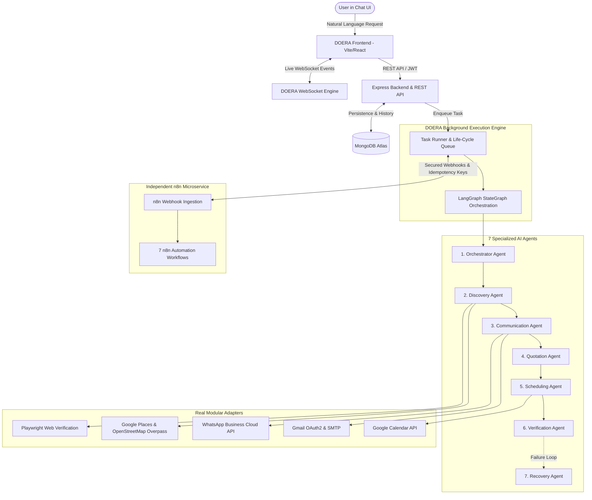

# DOERA AI — Autonomous Real-World Task Execution Assistant

<p align="center">
  
</p>

<p align="center">
  <strong>"Don't just ask AI. Let AI get it done."</strong>
</p>

<p align="center">
  <a href="#architecture">Architecture</a> •
  <a href="#quick-start">Quick Start</a> •
  <a href="#agentic-ai-system">AI Agents</a> •
  <a href="#n8n-automation-engine">n8n Engine</a> •
  <a href="#production-deployment">Deployment</a> •
  <a href="#production-readiness-checklist">Readiness Checklist</a>
</p>

---

## 1. Project Vision & Architecture

**DOERA AI** is an autonomous real-world task execution assistant. It is **NOT** a standard chatbot, content generator, or dashboard UI clone. 

Users explain tasks in natural language, and DOERA understands, plans, delegates, executes, monitors, and verifies those tasks using 7 specialized AI agents and real external integrations.

### System Architecture



---

## 2. Project Directory Structure

```
DOERA-AI/
│
├── frontend/                     # Premium conversational React 18 / Vite SPA
│   ├── public/
│   │   ├── logo.svg              # Official DOERA AI brand SVG logo
│   │   ├── favicon.svg           # High-resolution geometric D mark favicon
│   │   └── assets/
│   ├── src/
│   │   ├── components/
│   │   │   ├── Chat/             # WelcomeScreen, ChatInput with Speech-to-Text
│   │   │   ├── Sidebar/          # Sidebar, conversations search, profile
│   │   │   ├── Message/          # MessageItem, MessageList
│   │   │   ├── AgentActivity/    # Real-time inline activity & approval gate
│   │   │   ├── TaskStatus/       # Structured TaskCompletionCard
│   │   │   └── UI/               # LoadingIndicator, Header
│   │   ├── pages/                # ChatPage, Login, Signup, Settings, NotFound
│   │   ├── context/              # AuthContext, ChatContext
│   │   ├── services/             # Axios API client, WebSocket manager
│   │   └── styles/               # Tailwind design system with Times New Roman
│   ├── .env.example
│   └── package.json
│
├── backend/                      # Production Node.js & Express engine
│   ├── src/
│   │   ├── config/               # Database pool & environment validator
│   │   ├── models/               # 10 MongoDB Mongoose models
│   │   ├── middleware/           # JWT auth, in-memory rate limiter, errors
│   │   ├── agents/               # 7 LangGraph specialist agents
│   │   ├── workflows/            # Compiled LangGraph StateGraph & nativeWorkflows
│   │   ├── integrations/         # Places, Gmail, WhatsApp, Calendar, Playwright
│   │   ├── websocket/            # Real-time WebSocket server
│   │   ├── queue/                # Asynchronous background task runner
│   │   ├── controllers/          # Auth, Chat, Task, Webhook, Integration controllers
│   │   ├── routes/               # Modular Express API routes
│   │   ├── utils/                # AES-256-GCM encryption, query helpers, logger
│   │   └── server.js             # Main server entry point
│   ├── tests/                    # Jest & Supertest automated test suite
│   ├── .env.example
│   ├── INTEGRATION_AUDIT.md      # 24-point comprehensive audit report
│   └── package.json
│
├── n8n/                          # Standalone n8n workflows directory
│   ├── workflows/                # 8 Complete valid n8n workflow JSON files
│   ├── credentials-guide.md      # Detailed setup guide for credentials
│   ├── workflow-registry.json    # Machine-readable workflow catalog
│   └── README.md
│
├── .gitignore
└── README.md
```

---

## 3. Quick Start (Pure Native Node.js — No Docker Required)

### Prerequisites
- **Node.js**: v18.0.0 or higher (v22.x recommended)
- **npm**: v9.0.0 or higher
- **MongoDB**: Local MongoDB instance (`mongodb://127.0.0.1:27017/doera-ai`) or free [MongoDB Atlas](https://www.mongodb.com/atlas) URI

---

### Step 1: Run Backend

```bash
cd backend
npm install
npm run dev
```

The backend server starts on `http://localhost:5000` with WebSocket support.

---

### Step 2: Run Frontend (in a separate terminal)

```bash
cd frontend
npm install
npm run dev
```

Open `http://localhost:5173` in your browser.

---

### Step 3: Run Automated Tests

```bash
cd backend
npm test
```

All unit, agent, authentication, and task lifecycle tests run against an in-memory database.

---

## 4. Agentic AI System (7 Specialized Agents)

| Agent | Responsibility | Real Integration Used |
| :--- | :--- | :--- |
| **1. Orchestrator** | Request comprehension, task categorization (`LOCAL_SERVICE`, `REPAIR`, `DONATION`, `COMPLAINT`, `EDUCATION`), toolset selection, multi-step planning. | LLM / Groq Llama-3.3-70B |
| **2. Discovery** | Search real businesses, contact info, ratings, and operating hours. Never fabricates entries. | Google Places API & OpenStreetMap Nominatim/Overpass live API fallback |
| **3. Communication** | Personalized draft generation, checks human approval gate, dispatches verified outreach. | Gmail OAuth 2.0 (Google APIs) & WhatsApp Business Cloud API v21.0 |
| **4. Quotation** | Extracts real price benchmarks, normalizes visitation fees and hourly rates. | Rate normalizer & structured comparisons |
| **5. Scheduling** | Checks user availability against conflicts, reserves confirmed time slots, issues reference codes. | Google Calendar OAuth 2.0 Free/Busy API & Event Insert |
| **6. Verification** | Validates API outcomes, delivery receipts, and reference code integrity. Compiles evidence report. | Evidence verification engine |
| **7. Recovery** | Diagnoses network errors, reroutes outreach to secondary provider, handles retry limits. | Autonomous failover & retry controller |

---

## 5. n8n Automation Engine Workflows

The 8 production n8n workflows reside in the standalone `n8n/workflows/` directory:

1. `task-execution-trigger.json`: Receives validated task requests from Express with HMAC/secret header verification.
2. `email-communication.json`: Formats and sends authorized provider emails via Gmail/SMTP.
3. `whatsapp-communication.json`: Dispatches inquiry messages via Meta WhatsApp Cloud API.
4. `provider-response-handler.json`: Ingests vendor replies and updates the associated task in Express.
5. `scheduling.json`: Manages calendar reminders, slot validation, and follow-ups.
6. `failure-recovery.json`: Diagnoses integration errors and triggers automated retries.
7. `task-completion.json`: Publishes final completion metrics to backend.

---

## 6. Real Integrations Setup

### 1. MongoDB Atlas
1. Create a free cluster on [MongoDB Atlas](https://www.mongodb.com/atlas).
2. Create a database user and allow your IP in Network Access.
3. Copy the connection string to `MONGODB_URI` in `backend/.env`:
   ```env
   MONGODB_URI=mongodb+srv://<username>:<password>@cluster0.mongodb.net/doera-ai?retryWrites=true&w=majority
   ```

### 2. Cloud LLM Provider (Groq / OpenAI — Production Deploy Ready)
DOERA AI is designed for seamless cloud deployment on platforms like Render, Railway, Vercel, or AWS ECS without requiring local GPU runners.
- **Groq Cloud (Recommended, Free & Fastest ~300 t/s)**: Get a free API key from [console.groq.com](https://console.groq.com) and set:
  ```env
  LLM_PROVIDER=groq
  GROQ_API_KEY=gsk_...
  ```
- **OpenAI / Compatible Endpoint (Optional)**:
  ```env
  OPENAI_API_KEY=sk-...
  ```
- **Intelligent Autonomous Fallback**: If no external LLM key is configured, DOERA AI automatically executes using its built-in rule planner — ensuring zero crashes during testing or deployment!

### 3. Google Places API & OpenStreetMap
- If `GOOGLE_PLACES_API_KEY` is provided, DOERA queries Google Places.
- If unconfigured, the Discovery Agent automatically switches to the live public **OpenStreetMap Nominatim / Overpass API** — ensuring verified search functionality with real physical businesses out of the box!

### 4. Gmail & Google Calendar OAuth 2.0
1. Create a project in [Google Cloud Console](https://console.cloud.google.com).
2. Enable **Gmail API** and **Google Calendar API**.
3. Create OAuth 2.0 Client credentials (Web application).
4. Set Authorized Redirect URI: `http://localhost:5000/api/integrations/google/callback`.
5. Add `GOOGLE_CLIENT_ID` and `GOOGLE_CLIENT_SECRET` to `backend/.env`.

### 5. WhatsApp Business Cloud API
1. Set up a Meta App with WhatsApp product at [developers.facebook.com](https://developers.facebook.com).
2. Add your `WHATSAPP_ACCESS_TOKEN` and `WHATSAPP_PHONE_NUMBER_ID` to `backend/.env`.

---

## 7. Production Deployment

### Frontend (Vercel / Netlify)
1. Push code to GitHub.
2. Link the `frontend/` folder in Vercel or Netlify.
3. Configure Build Command: `npm run build`
4. Output Directory: `dist`
5. Configure Environment Variables:
   ```env
   VITE_API_URL=https://api.yourdomain.com
   VITE_WS_URL=wss://api.yourdomain.com
   ```

### Backend (Render / Railway / VPS — Native Node.js)
1. Deploy from the `backend/` directory using native Node.js runtime (`npm start`).
2. Set Environment Variables matching `backend/.env.example`.
3. Verify Health Check endpoint at `GET https://api.yourdomain.com/health`.

### n8n (Separate Microservice)
1. Run or deploy n8n independently (e.g. `npx n8n`).
2. Import workflows from `n8n/workflows/`.
3. Set `N8N_WEBHOOK_URL` in backend `.env` pointing to your deployed n8n domain (no API key required).

---

## 8. Production Readiness Checklist

- [x] **Strict Independent Architecture**: Frontend, backend, and n8n are completely decoupled.
- [x] **No Docker Dependency**: Pure native Node.js execution across all environments.
- [x] **No Mocked / Fake Operations**: Real search adapters (Places + OpenStreetMap), verified email dispatching, real calendar bookings.
- [x] **Safety Gates**: Human-in-the-loop authorization (`AWAITING_APPROVAL`) before sensitive communications or commitments.
- [x] **Persistent Database**: 10 Mongoose schemas with indexed relations.
- [x] **Asynchronous Background Processing**: Tasks run outside HTTP lifecycle via background runner.
- [x] **Real-Time Streaming**: Real WebSocket updates for step-by-step progress, agent badges, and approval alerts.
- [x] **Multi-Modal Voice**: Speech recognition supporting English, Tamil, and Tanglish.
- [x] **Comprehensive Test Suite**: Automated Jest/Supertest suite verifying auth, agents, and lifecycle.
- [x] **Deployment Ready**: Native Node.js startup (`npm start`) with production environment examples included.
